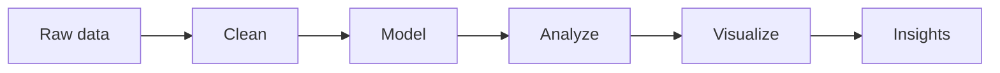

  
   
  
   
  
   
  
   
  
  
  
  

## 👋 About Me

I am a data professional with 8+ years of experience working with high-volume records in healthcare and Umrah logistics. Today I lead a team of 6 at DMTCSA that processes 12,000+ Nusuk Platform registrations per season. I am moving into data analysis, and I am looking for an entry-level Data Analyst role where I can combine my data quality background with SQL, Power BI and Excel.

## 💡 What I Bring

- **Data quality:** I raised matching accuracy between our internal records and the Nusuk Platform from 70% to 90%, and cut manual entry errors by 40% in my previous role through structured validation checks.
- **Team leadership:** I redesigned the registration process and divided the work across the team, improving workflow efficiency by 30%.
- **Analytics skills:** SQL Server queries, data modeling (star schema), DAX measures and interactive Power BI dashboards, built during my NTI data analysis program.
- **ERP knowledge:** Microsoft Dynamics 365 SCM training through DEPI, including a hands-on inventory setup project.

## 🔄 How I Work With Data

Python · Power Query &nbsp;→&nbsp; Star schema &nbsp;→&nbsp; SQL · DAX &nbsp;→&nbsp; Power BI

## 🧰 Tools & Technologies

**📊 Data & Analytics**

  
  
  
  
  
  
  
  

**🏭 ERP & Business Systems**

  
  
  
  

**⚙️ Dev & Productivity**

  
  
  

**🗣️ Languages:** Arabic (Native) · English (Intermediate) · German (A2+)

## 📌 Featured Projects

| Project | Tools | What it shows |
|---|---|---|
| **Supply Chain Analysis (DataCo)** | Python, SQL Server, Power BI | Cleaned 180,519 order items, answered 38 business questions in SQL, built a 5-page dashboard |
| **Bilal Cycles Sales Dashboard** | Power BI, DAX, SQL Server | Star schema, 15 DAX measures, 3 report pages on 31K orders |
| **Call Center Dashboard** | Excel, Power Query | KPI tracking for call volume, duration, response time and satisfaction |
| **HR KPIs Dashboard** | Power BI | Workforce and HR metrics across departments |
| **BikeStores SQL Analysis** | SQL Server | 24 business questions answered with SQL queries |
| **Techno Steel Inventory Setup** | Dynamics 365 SCM | Master data for 57 products, 1 site and 3 warehouses |

All projects were completed as part of NTI and DEPI training programs.

## 🎓 Education & Certifications

- 📘 **Data Analysis: Skills for the Freelance Professional**, National Telecommunication Institute (NTI), in progress
- 📘 **Management & ERP: MSD Supply Chain Application Consultant**, Digital Egypt Pioneers Initiative (DEPI), 2026
- 📜 Complete SQL Course and Data Analysis With Excel, DataSkool, 2026
- 📜 AI Fundamentals with Capstone Project, IBM SkillsBuild, 2026
- 🇩🇪 German Language Program, Level A1 (150 hours), Education Development Fund, 2026
- 🎓 Bachelor of Law, Alexandria University, 2020

## 🌱 Right Now

- 📚 Completing the NTI data analysis program (technical track finished)
- 🔎 Looking for an entry-level Data Analyst or Dynamics 365 SCM role
- 🇩🇪 Learning German

## 📈 GitHub Stats

  
   
  

## 📫 Let's Connect

  Open to entry-level Data Analyst and Dynamics 365 SCM roles in Egypt and abroad.
   
  <a href="https://www.linkedin.com/in/mostafa-bilal">LinkedIn</a> · <a href="mailto:mostafa.mohamed.bilal@gmail.com">mostafa.mohamed.bilal@gmail.com</a>
    
  <i>📈 Every dataset tells a story. I am here to find it.</i>

  

